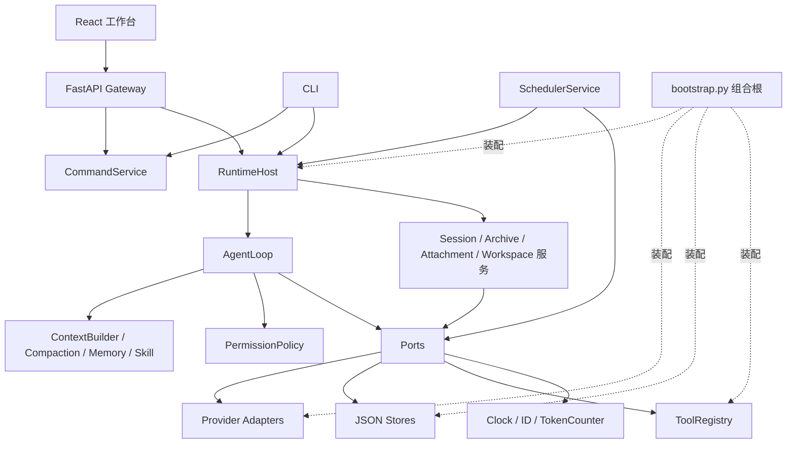
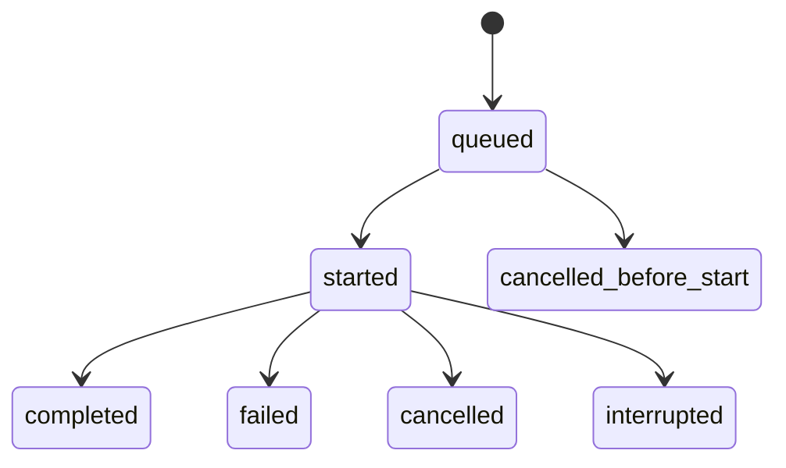
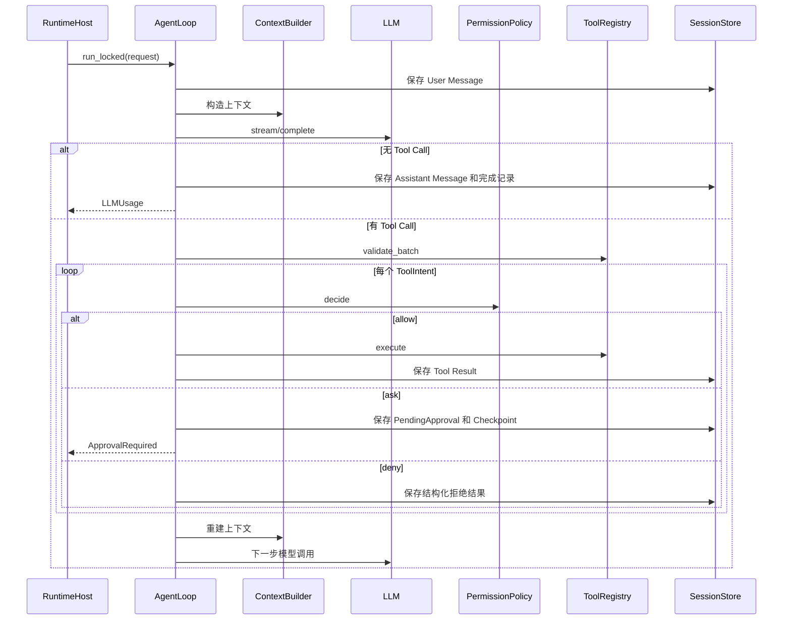
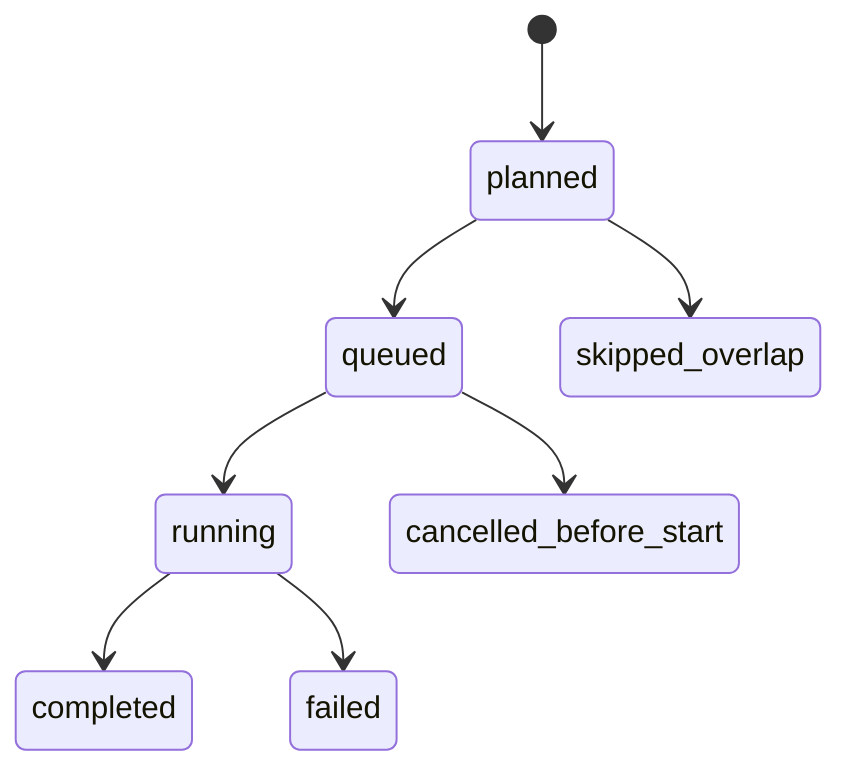

# SJTUClaw 详细设计文档

> 文档性质：当前实现说明（as-built design）  
> 适用版本：仓库当前 `0.1.0` 实现  
> 主要读者：项目维护者、课程验收人员、后续功能开发者

## 1. 文档目标

本文从代码实现角度说明 SJTUClaw 的整体架构、模块职责、核心数据模型、关键运行流程、安全边界、持久化方式、前端交互和测试策略。

本文描述的是当前代码已经采用的设计，不是未来功能提案。若本文与代码存在差异，以 `src/sjtuclaw/`、`web/src/` 和测试为准。

### 1.1 系统定位

SJTUClaw 是一个面向 Agent Runtime 学习与实践的本地模块化单体应用：

- Python 3.12 实现 Agent Runtime、FastAPI Gateway、CLI、Scheduler 和本地持久化。
- React 19 + TypeScript 实现浏览器工作台。
- 默认连接 DeepSeek，也支持 OpenAI 兼容协议和 Anthropic 协议。
- 支持多会话、流式回答、Tool 调用、权限审批、附件、工作区、Skill、长期记忆、上下文压缩和定时任务。
- 运行数据默认保存在本机 `.sjtuclaw/`，不依赖外部数据库。

### 1.2 设计目标

系统重点保证以下性质：

1. **入口统一**：CLI、Web 和 Scheduler 最终都提交同一种 `RuntimeRequest`。
2. **领域与基础设施分离**：Runtime 通过 Ports 使用 LLM、Store、Tool、Clock 等外部能力。
3. **会话内顺序一致**：同一 Session 的请求串行执行，不同 Session 可以并行。
4. **过程可恢复**：已接收请求、Run 状态、审批检查点和关键审计信息持久化。
5. **副作用受控**：Tool 先验证，再经过 `PermissionPolicy`，写入和执行操作不能绕过审批。
6. **敏感信息不外泄**：API Key、绝对内部路径、原始 Provider 错误和思考内容不进入公开接口。
7. **实现可测试**：时间、ID、LLM、Store 和 Tool 都有可替换边界。

### 1.3 非目标

当前实现不提供：

- 多用户、远程部署或公网访问。
- 操作系统级容器沙箱。
- 分布式任务队列和多进程写入协调。
- 数据库事务；当前持久化基于严格 JSON 和原子文件替换。
- 向量数据库；长期记忆使用本地确定性排序。
- 前端状态管理框架；页面状态主要由 React Hooks 管理。

## 2. 技术栈与目录

### 2.1 技术栈

| 层 | 技术 |
| --- | --- |
| 核心语言 | Python 3.12 |
| HTTP Gateway | FastAPI、Uvicorn |
| LLM HTTP 客户端 | HTTPX |
| 数据校验 | dataclass 不变量、Pydantic 请求模型、JSON Schema |
| 本地持久化 | UTF-8 JSON、原子文件替换 |
| PDF/PPT | pypdf、pdfplumber、reportlab、python-pptx |
| 前端 | React 19、TypeScript、Vite |
| Markdown 展示 | react-markdown、remark-gfm、rehype-sanitize |
| Python 测试与检查 | pytest、ruff、mypy |
| 前端测试 | Vitest、TypeScript build |

### 2.2 顶层目录

```text
new_computer_programming_practice/
├── src/sjtuclaw/        Python 应用
├── web/                 React 工作台
├── skills/              可编辑的本地 Skill 源
├── tests/               单元、契约、集成和 live 测试
├── docs/                使用、设计、验收文档
├── scripts/             辅助脚本
├── vendor/              可选本地 Tokenizer
├── pyproject.toml       Python 包和检查配置
└── README.md            启动和使用入口
```

运行时生成的 `.sjtuclaw/`、`build/`、缓存目录和 `web/dist/` 不属于业务源码。

## 3. 总体架构

### 3.1 分层结构



### 3.2 各层职责

| 层 | 目录 | 主要职责 |
| --- | --- | --- |
| 入口层 | `entrypoints/`、`web/src/` | 协议转换、认证、请求校验、SSE、页面交互 |
| 应用层 | `runtime/` | 用例编排、并发控制、状态机、领域规则 |
| 领域模型 | `models/` | 不可变数据结构和数据不变量 |
| 抽象端口 | `ports/` | Store、LLM、Tool、Clock 等依赖接口 |
| 基础设施 | `infrastructure/` | Provider、JSON Store、Tokenizer 和具体 Tool |
| 组合根 | `bootstrap.py` | 创建对象并连接依赖 |
| 配置与提示词 | `config.py`、`prompts/` | 环境配置、Provider 配置、系统提示词 |

### 3.3 依赖规则

依赖方向遵循：

```text
Entrypoints -> Runtime -> Models + Ports
Infrastructure ---------> Models + Ports
Bootstrap -----> Entrypoints 以外的所有具体实现
```

关键约束：

- `models` 不依赖 FastAPI、React、具体 Provider 或文件系统实现。
- `runtime` 使用 `ports`，不直接绑定 JSON 文件格式或 HTTP 协议。
- `infrastructure` 实现端口，不负责决定会话状态、审批语义和调度业务规则。
- `bootstrap.py` 是组合根，具体实现的选择集中在这里。

## 4. 启动与组合根设计

### 4.1 配置加载

`config.py` 中的 `Settings` 负责：

- 从 `.env` 和进程环境变量加载配置。
- 对必填项、整数范围、URL、Token 阈值关系进行启动期校验。
- 使用 `field(repr=False)` 避免 API Key 出现在对象表示中。
- 根据模型生成 `ModelProfile`，提供显示名和上下文窗口。

配置优先级为：

```text
代码默认值 < .env < 进程环境变量
```

Provider 连接配置由 `ProviderConfiguration` 表示，包含：

- `provider`
- `model`
- `base_url`
- `api_key`
- `thinking_enabled`

### 4.2 应用装配

`bootstrap.py` 的 `build_cli_application()` 创建一个 `RuntimeApplication`。主要装配顺序：

1. 创建系统时钟和 UUID ID 生成器。
2. 创建 Session、Memory、Attachment、Task、Skill Snapshot 等 Store。
3. 创建共享 `SessionCoordinator`。
4. 创建 Session、Attachment、Workspace、Memory、Prompt、Skill 等应用服务。
5. 创建 `ProviderRuntime` 和相应 Token Counter。
6. 创建 `ContextBuilder`、`CompactionService` 和 `MemoryCapture`。
7. 注册只读 Tool 和高级 Tool，构造 `ToolRegistry`。
8. 根据 ToolDefinition 构造 `PermissionPolicy`。
9. 创建 `RuntimeHost`、`SchedulerService` 和 `ArchiveService`。
10. 返回统一的应用对象，并由 `aclose()` 按顺序释放后台任务、Shell 和 HTTP 客户端。

该方式把“创建什么实现”的决定限制在组合根中，测试可以直接传入 Fake 实现。

## 5. 核心领域模型

领域模型主要使用 `frozen=True, slots=True` 的 dataclass。不可变对象配合 `dataclasses.replace()` 形成显式状态转换，减少共享可变状态。

### 5.1 Session 聚合

`models/session.py` 中的 `Session` 是最重要的持久聚合，包含：

- 会话身份和标题：`session_id`、`title`
- 对话：`messages`、`summary`、`next_sequence_number`
- 请求与运行：`pending_requests`、`runs`
- 审计：`run_records`
- 工作区：`workspace_binding`
- 审批：`pending_approval`、`approval_decisions`
- Skill：`explicit_skill_refs`、`skill_usages`
- Token 累计数据
- 归档状态

`Session.__post_init__()` 负责校验聚合不变量，例如：

- Message ID、Run ID、Request ID、Decision ID 不重复。
- Message 和 RunRecord 的序号严格递增。
- `next_sequence_number` 必须大于已有消息序号。
- PendingApproval 必须关联存在的 Run 和匹配的 Checkpoint。
- 工作区绑定 ID 和 revision 必须与待审批记录一致。
- Skill 最多选择三个，且 ID 不重复。
- 归档时间和归档原因必须同时存在或同时为空。

### 5.2 Message

`models/message.py` 把 Provider 格式转换为统一消息模型：

- `SYSTEM`
- `USER`
- `ASSISTANT`
- `TOOL`

消息同时保存结构化 Tool Call、Tool Result 元数据、附件引用和 steer 输入类型。

边界规则：

- 附件引用只允许出现在 User Message。
- Tool Call 只允许出现在 Assistant Message。
- Tool Result 必须有 `tool_call_id`。
- Error Tool Result 必须有稳定 `error_code`。
- `reasoning_content` 只属于 Assistant Message，但不会通过 Gateway 的公开事件输出。

### 5.3 RuntimeRequest 与 RuntimeEvent

所有入口共享 `models/runtime.py`：

```text
RuntimeRequest
├── request_id / session_id
├── source: cli | gateway | scheduler
├── user_input
├── attachment_refs
├── idempotency_key
├── scheduler 受信任字段
└── skill_refs / automatic_skill_ids
```

`RuntimeEvent` 是运行时内部事件，带：

- 事件类型
- Session ID
- Invocation ID
- 单调序号
- 调用来源
- 不可变 Payload

事件覆盖接收、排队、启动、流式增量、Tool、审批、压缩、完成、失败、取消和 steer。

### 5.4 Run 状态

`RunStatus`：



`RunState` 只保存小型运行摘要；完整对话仍保存在 `Session.messages`。

完成态 Run 必须具备：

- `started_at`
- `completed_at`
- `duration_ms`
- `assistant_message_id`

需要审批时，Run 保存 `RunCheckpoint`，其中包含恢复所需的最小数据，不保存任意可执行对象。

### 5.5 Tool 与权限模型

`models/tool.py` 把 Tool 生命周期分成多个类型：

1. `ToolDefinition`：名称、说明、输入 JSON Schema、安全级别。
2. `ToolCall`：Provider 返回的原始调用。
3. `ToolIntent`：通过 Schema 验证并补充目标资源后的调用。
4. `AuthorizedToolCall`：只能由 `PermissionPolicy` 创建的执行能力。
5. `ToolResult`：结构化成功或错误结果。

安全级别：

- `READ_ONLY`
- `WRITE`
- `EXECUTE`

这种设计避免“参数合法”等同于“允许执行”，验证和授权是两个独立阶段。

### 5.6 其他模型

| 模型文件 | 主要对象 | 设计重点 |
| --- | --- | --- |
| `attachment.py` | `Attachment`、`AttachmentRead` | 状态、哈希、大小和规范化文本元数据 |
| `memory.py` | `MemoryEntry`、`Memory` | 分类、重要度、来源、事件时间、revision |
| `scheduler.py` | `Schedule`、`Task`、`Occurrence` | 四类计划、任务与发生记录分离 |
| `skill.py` | `SkillManifest`、`SkillSnapshot`、`SkillReference` | 内容寻址、不可变快照、使用审计 |
| `llm.py` | `LLMRequest`、`LLMResponse`、`LLMUsage` | Provider 无关的模型协议 |
| `run_record.py` | `RunRecord` | 清理后的持久审计记录 |
| `compaction.py` | `CompactionResult` | 压缩状态和 Token 统计 |

## 6. Ports 设计

`ports/` 使用 Python `Protocol` 定义应用层需要的能力。

### 6.1 主要端口

| 端口 | 职责 |
| --- | --- |
| `LLMClient` / `StreamingLLMClient` | 完整回答和流式回答 |
| `SessionStore` | Session CRUD |
| `MemoryStore` | 跨 Session 记忆文档读写 |
| `AttachmentStore` | 附件接收、读取、分页和删除 |
| `TaskStore` | Task 和 Occurrence 持久化 |
| `SkillSnapshotStore` | Skill 清单、快照和资源读取 |
| `ToolExecutor` | Tool 定义、批量验证和执行 |
| `TokenCounter` | 完整 LLMRequest 的 Token 计数 |
| `Clock` | UTC 时间和单调计时 |
| `IdGenerator` | 带业务前缀的稳定 ID |

### 6.2 端口价值

- Runtime 测试无需真实网络和磁盘。
- JSON Store 与 InMemory Store 可执行同一契约测试。
- Provider Adapter 可以更换而不修改 AgentLoop。
- 虚拟 Clock 能确定性测试 Scheduler 和超时逻辑。

## 7. Runtime 核心设计

### 7.1 RuntimeHost：接收、排队和并发

`runtime/service.py` 分成两层：

- `AgentRuntime`：执行单个请求的基础能力。
- `RuntimeHost`：持久队列、跨 Session 调度、审批恢复、停止、steer 和崩溃恢复。

`RuntimeHost.submit()` 的核心边界：

1. 校验 Session 可写和附件可用。
2. 自动补充默认 Skill。
3. 在 admission lock 下持久化 `PendingRequest` 和 queued `RunState`。
4. 返回 `RunHandle`，让调用方订阅事件。
5. 将 Session 放入全局可运行队列。

并发语义：

- `SessionCoordinator.admission_lock(session_id)` 保护接收、队列和聚合合并。
- `SessionCoordinator.execution_lock(session_id)` 保证同一 Session 同时只执行一个 Run。
- 全局调度允许不同 Session 的工作独立推进。
- Session 管理操作复用同一协调器，避免重命名、删除、归档与运行保存发生竞态。

`RunHandle` 提供：

- 异步事件迭代。
- 等待任务结束。
- 取消运行。
- 终态检测。

### 7.2 AgentLoop：模型与 Tool 闭环

`runtime/agent_loop.py` 在已持有 Session execution lock 的条件下执行完整轮次。



循环保护：

- `agent_max_steps` 限制单轮最大模型步骤数。
- `agent_repeat_call_limit` 限制连续相同 Tool 签名。
- 批量 Tool Call 先整体验证，避免部分非法批次产生副作用。
- 每个 Tool Result 及时持久化，终态不会抹去已发生的副作用记录。
- 取消时保留已保存的 User Message 和审计记录。

### 7.3 流式输出

如果 Provider 实现 `StreamingLLMClient`：

- `AgentLoop` 将文本增量发布为 `ASSISTANT_DELTA`。
- 只有完整 Assistant Message 才写入 Session。
- 中途断流不会把半条 Assistant Message 当成持久事实。
- Tool Call 在流结束后组装为完整结构，再进入验证阶段。

### 7.4 Steer

`run_control.py` 管理对运行中或排队中请求的 steer：

- 用 `steer_id` 和 `idempotency_key` 保证重复请求稳定。
- 运行中 steer 等待 AgentLoop 安全点。
- 应用 steer 后重置步骤计数和重复 Tool 计数。
- steer 以 `UserInputKind.STEER` 写入消息，但不作为自动记忆的用户原始输入。

### 7.5 审批恢复

普通聊天中的 WRITE/EXECUTE Tool 默认返回 `ASK`：

1. AgentLoop 保存 `PendingApproval`。
2. Run 保存 `RunCheckpoint`。
3. 当前执行释放全局运行资源。
4. 用户通过 Gateway 提交 approve 或 deny。
5. `RuntimeHost` 持久化幂等 `ApprovalDecision`。
6. approve 后重新进入公平队列，从 Checkpoint 恢复。
7. 恢复时重新校验 Tool 注册、Workspace 绑定和 revision。

审批不是永久授权，只对应一次具体 Tool Call。

## 8. 上下文、压缩与 Token

### 8.1 ContextBuilder

`runtime/context_builder.py` 按稳定顺序构造 Provider 上下文：

1. System Prompt + Soul。
2. 检索到的长期记忆。
3. 可用 Skill 索引。
4. 本轮已选择 Skill 的完整说明。
5. Session Summary。
6. Session Messages。
7. 紧跟相关 User Message 的附件元数据提示。

Skill 内容被明确标注为“不受信任的指导，不是权限授予”。

附件正文不会一次性塞入上下文。模型先看到元数据，再通过 `read_attachment` 分段读取。

### 8.2 CompactionService

自动压缩发生在模型调用前：

- 计算完整上下文 Token，加上模型输出预留。
- 未达到触发阈值时不压缩。
- 保留最近若干个完整对话轮次。
- 旧消息和已有 Summary 交给模型生成新 Summary。
- 新 Summary 通过格式、长度和安全校验后才保存。
- 压缩失败时保留旧 Session；若已超过硬预算则终止 Run。

压缩只移除完整旧轮次，不拆开 Assistant Tool Call 与 Tool Result 交换。

### 8.3 Token Counter

- DeepSeek 可使用本地精确 Tokenizer。
- 其他 Provider 或缺少 Tokenizer 时使用近似计数器。
- `ProviderRuntime` 同时租用 LLM Client 和 Token Counter，避免运行中切换 Provider 后计数规则变化。
- Session 累计 prompt、cache hit、cache miss 和 completion Token。

## 9. Provider 模块

### 9.1 ProviderRuntime

`runtime/provider_runtime.py` 使用 `ContextVar` 保存当前异步任务的 Provider Lease。

切换 Provider 时采用 prepare/activate：

1. `prepare()` 先创建新 Client 和 Token Counter。
2. Gateway 持久化新配置。
3. 持久化成功后 `activate()`。
4. 持久化失败则 `discard()` 新 Client。

已开始的 Run 保持旧 Lease，新 Run 使用新配置。因此运行中的请求不会因设置切换而改变协议、模型或 Token 规则。

### 9.2 Provider Adapter

`infrastructure/llm/`：

- `deepseek.py`：DeepSeek 请求、流式 SSE、重试、Tool Call 组装。
- `openai_compatible.py`：复用 OpenAI 风格 Chat Completions 协议。
- `anthropic.py`：Anthropic Message 协议和内容块转换。
- `tool_protocol.py`：native/json Tool 模式序列化和解析。

Adapter 负责：

- 将统一 `LLMRequest` 转换为 Provider 请求。
- 将 Provider 响应转换为 `LLMResponse` / `LLMStreamEvent`。
- 把网络、认证、限流和协议错误映射为安全内部异常。
- 不把原始响应体或认证头传播到 Gateway。

## 10. Tool、Workspace 与下载

### 10.1 ToolRegistry

`infrastructure/tools/registry.py`：

- 注册唯一名称的 Tool。
- 暴露 `ToolDefinition`。
- 使用 JSON Schema 严格验证参数。
- 将原始调用转换为 `ToolIntent`。
- 按原顺序执行已授权调用。

主要 Tool：

| 类别 | Tool |
| --- | --- |
| 只读 | 文件读取、目录列出、附件读取、Skill 资源读取 |
| 写入 | `copy_attachment_to_workspace`、`write_file`、`create_download` |
| 执行 | `new_shell`、`run_command` |
| Skill | `select_skill` |

### 10.2 PermissionPolicy

决策逻辑：

- 未注册 Tool：`DENY`
- ToolDefinition 与 ToolIntent 安全级别不一致：`DENY`
- 合法只读 Tool：通常 `ALLOW`
- 普通 CLI/Gateway 的写入或执行：`ASK`
- Scheduler：只有 Task 的托管权限类别、Workspace revision 和当前绑定全部匹配时才 `ALLOW`

`.git`、`.env` 和 `.env.*`（`.env.example` 除外）被视为敏感路径。

### 10.3 Workspace

`WorkspaceService` 把一个规范化目录绑定到 Session：

- 保存 `binding_id`、规范路径、显示路径和递增 revision。
- 绑定变更必须在 Session 空闲时完成。
- Tool 参数只接受相对路径。
- 执行时用受信任的 `ToolExecutionContext.workspace_root` 重建路径边界。
- 模型不能通过 Tool 参数提供 Workspace 根路径或伪造 revision。

### 10.4 持久 Shell

`PersistentShellManager` 为每个 ToolExecutionContext 管理易失 Shell：

- `new_shell` 在 Workspace 内启动或替换 Shell。
- `run_command` 复用 Shell 的当前目录和环境。
- 超时、输出上限、离开 Workspace 和协议异常都有稳定错误码。
- PID、管道、环境变量和真实内部路径不写入 Session。
- 应用关闭或 Tool 上下文结束时释放进程。

### 10.5 DownloadSnapshotService

`create_download` 把 Workspace 中的文件发布为短期不可变下载快照：

- 快照绑定 Session。
- Gateway 只提供读取既有快照的 endpoint。
- 文件创建仍必须经过 AgentLoop 和 PermissionPolicy。
- 启动和关闭时清理过期或孤立快照。

## 11. 附件模块

### 11.1 AttachmentService

`runtime/attachment_service.py` 负责用例规则：

- Session 必须存在且未归档。
- 上传、删除和请求提交共享 admission 边界。
- 已被 PendingRequest 引用的附件不能删除。
- 仅 READY 附件可以绑定到新请求。

### 11.2 JsonAttachmentStore

`infrastructure/persistence/attachments.py` 负责文件处理：

- 支持 UTF-8 文本和 PDF。
- 原始文件、规范化文本和元数据一起发布。
- 上传先进入 staging 目录，成功后原子替换为最终目录。
- 文本统一换行并计算 SHA-256。
- PDF 在可终止的辅助进程中抽取文本，限制页数、时间和资源。
- 通过 opaque cursor 分段读取规范化文本。
- Attachment ID 按 Session 隔离，拒绝跨 Session 读取。

附件状态：

```text
UPLOADING -> PROCESSING -> READY
                       -> FAILED
```

## 12. 长期记忆模块

### 12.1 数据模型

`MemoryEntry` 支持：

- 类别：identity、preference、project、constraint、event、other。
- 重要度：1 到 5。
- 来源：manual 或 automatic。
- 自动记忆来源 Session 和 Message。
- 原始时间文本、规范化 UTC 事件时间和时区。
- `revision` 乐观并发控制。

### 12.2 手动 CRUD

`MemoryService`：

- 列表支持查询、稳定排序和 opaque cursor。
- 创建、修改、删除统一通过 `MemoryCoordinator` 串行。
- 更新和删除可校验 revision，冲突返回明确错误。
- 内容经过敏感信息安全检查。

### 12.3 自动提取

Assistant Message 成功保存后，`MemoryCapture` 静默执行：

1. 找到当前完成 Run 对应的 User、Tool Result 和 Assistant 内容。
2. 读取当前 Memory Policy。
3. 检索可能相关的已有记忆。
4. `MemoryExtractor` 调用 LLM 返回结构化 add/update/delete 操作。
5. `MemoryService.apply_automatic_batch()` 校验并一次应用。

仅 CLI 和 Gateway 会触发自动记忆；Scheduler 不触发。提取失败不会让已经成功的聊天 Run 失败。

### 12.4 本地检索

`LocalMemoryRetriever` 不调用向量服务。排序信号包括：

- 查询完整子串。
- 英文/数字 Token 重合。
- 中文二元组重合。
- identity、preference、constraint 稳定类别加权。
- importance。
- 以 90 天为半衰期的更新时间衰减。

最终结果同时受条数和 Token 预算限制。

## 13. Skill 模块

### 13.1 Registry 与快照

`skills/registry.py` 扫描顶层 `skills/`：

- 解析 `SKILL.md` 元数据。
- 校验 Skill ID、资源路径、文件大小和总大小。
- 收集快照文件并计算 SHA-256。

`SkillService.refresh()` 将合法内容发布为不可变、内容寻址快照。Run 保存 `SkillReference`，而不是引用可变源目录。

这样即使用户在运行后修改 `skills/<id>/`，历史 Run 仍可对应原快照。

### 13.2 选择方式

Skill 最多同时选择三个：

- 显式：`/skill <name> <task>` 或 UI 选择。
- 自动：文本或附件命中 PDF/PPT 规则。
- Scheduler 显式：Task 固定保存 SkillReference。
- 模型选择：`select_skill` Tool。

自动选择逻辑位于 `runtime/skill_routing.py`，目前内置：

- PDF 附件或文本出现 `pdf` 时选择 `pdf`。
- 文本出现 ppt、PowerPoint、presentation、幻灯片、演示文稿、汇报时选择 `presentations`。

### 13.3 上下文与资源

- Skill 主说明由 `ContextBuilder` 放入系统上下文。
- 大型参考资料不自动全部注入。
- `read_skill_resource` 只允许读取本轮已选择快照中的相对资源。
- Skill 选择和资源读取写入 `SkillUsage`，用于 UI 和 CLI 审计。
- Skill 不提升 Tool 权限。

## 14. Scheduler 模块

### 14.1 计划类型

`ScheduleKind`：

- `once`
- `interval`
- `daily`
- `weekly`

规则保存 UTC anchor；日历计划额外保存时区、本地小时和分钟。`next_run_after()` 从不可变规则计算下一次时间，不从上一次完成时间累加，避免执行耗时造成漂移。

最小周期为 300 秒。

### 14.2 Task 与 Occurrence

`Task` 表示长期计划配置；`Occurrence` 表示某一次具体发生。

分离原因：

- Task 可以编辑、归档和恢复。
- 每次执行有独立状态、request_id、run_id 和错误码。
- 历史分页不需要把所有记录塞入 Task。
- retry 可以通过 `retry_of_occurrence_id` 保留来源。

Occurrence 状态：



### 14.3 SchedulerService

主要职责：

- 创建和校验 Task。
- 后台服务等待最近 `next_run_at`。
- 触发到期 Task，创建 Occurrence 并提交 `RuntimeRequest(source=scheduler)`。
- 同一 Task 不重叠执行；冲突时记录 `SKIPPED_OVERLAP`。
- 启动时恢复并对账未完成状态。
- 支持取消、编辑、归档、恢复、永久删除和失败重试。
- Session 归档时联动归档相关 Task。

Scheduler 提交的受信任字段包括 Task ID、Occurrence ID、Workspace revision 和托管权限类别。

## 15. Session 生命周期与归档

### 15.1 SessionService

`SessionService` 负责：

- 创建和加载 Session。
- 按更新时间列出活动或归档 Session。
- 在共享锁下重命名、删除、归档和恢复。

简单删除命令用于普通 Session 管理；完整归档流程由 `ArchiveService` 负责。

### 15.2 ArchiveService

归档采用可重试的阶段顺序：

1. 先持久化 Session 的 archived 标记。
2. 停止 Session 的活动和排队 Run。
3. 归档关联 Scheduler Task。

恢复 Session 时，Task 不自动恢复，避免恢复会话后旧自动任务意外重新执行。

永久删除仅允许已归档 Session，并级联删除：

- Scheduler Task 和 Occurrence
- Attachment
- Download Snapshot
- Session JSON

## 16. 本地命令系统

`runtime/commands.py` 提供 CLI 与 Web 共用的命令目录和执行逻辑。

`CommandOutcome` 分为：

- `lines`：临时展示文本。
- `effects`：刷新 Session、Memory、Skill 或切换当前 Session。
- `submission`：需要进入正常 Runtime 的显式 Skill 任务。

本地命令不会伪装成聊天消息，也不会写入 Run 历史或自动长期记忆。真正需要 LLM 的 `/skill <name> <task>` 会转换成普通 `RuntimeRequest`。

## 17. 持久化设计

### 17.1 数据布局

```text
<data_dir>/
├── sessions/<sha256(session_id)>.json
├── memory.json
├── memory_policy.json
├── prompts/
│   ├── system_prompt.md
│   └── soul.md
├── attachments/<session_id>/<attachment_id>/
│   ├── original
│   ├── normalized.txt
│   └── metadata.json
├── scheduler/
│   ├── tasks/<task_id>.json
│   └── occurrences/<task_id>/<sequence>-<occurrence_id>.json
├── skill-snapshots/
│   ├── manifest.json
│   └── <snapshot_id>/...
├── provider-settings.bin
└── downloads/<download_id>/...
```

实际 Provider Key 由当前 Windows 用户的数据保护能力加密，不以明文返回 UI。

### 17.2 JSON Store 原则

- 每份文档有 `schemaVersion`。
- 严格校验字段集合，未知字段和重复 JSON key 不被静默接受。
- 反序列化后再次执行领域模型不变量。
- 写入使用同文件系统临时文件 + `os.replace()`。
- 新内容失败时保留旧文件。
- Session 文件名使用 Session ID 的 SHA-256，避免路径型 ID。
- Store 对外只返回领域对象，不泄漏内部文件路径。

### 17.3 运行态与持久态边界

持久化：

- Session、Message、PendingRequest、RunState
- Approval、RunRecord、Token Usage
- Memory、Task、Occurrence
- Attachment 元数据和内容
- Skill Snapshot、Prompt、Provider 设置

不持久化：

- 活动 asyncio Task
- SSE 订阅者
- RunHandle 队列
- Shell 进程和句柄
- Provider HTTP 连接池
- 内存中的附件/Skill 分页 cursor 映射

## 18. Gateway 设计

### 18.1 安全边界

`entrypoints/gateway.py` 强制：

- 只允许绑定 `127.0.0.1`。
- 校验 Host。
- 修改类请求要求同源 Origin。
- 启动 URL 使用 fragment 携带一次性 bootstrap token。
- token 交换成功后设置 HttpOnly、SameSite=Strict Cookie。
- OpenAPI、Swagger 和 ReDoc 默认关闭。
- 响应设置严格 CSP。

bootstrap token 在 URL fragment 中，不会作为普通 HTTP 路径或 query 发送到服务端和日志；前端读取后主动交换。

### 18.2 API 分组

统一前缀为 `/api/v1`：

| 分组 | 主要能力 |
| --- | --- |
| Auth | 一次性 bootstrap |
| Sessions | 列表、创建、详情、重命名、删除、归档、恢复 |
| Requests/Runs | 提交、取消排队、停止、steer、SSE |
| Commands | 命令目录和执行 |
| Attachments | 上传、列表、删除 |
| Workspace | 绑定、选择、解绑 |
| Approvals | approve/deny |
| Memories | CRUD、分页、规则更新与重置 |
| Provider/Prompts | Provider 设置、Soul 设置 |
| Skills | 列表、详情、刷新 |
| Tasks | CRUD、归档、恢复、Occurrence 历史与重试 |
| Downloads | 读取已发布快照 |

请求模型使用 Pydantic 做长度、枚举、格式和未知字段校验。语义校验继续由 Runtime 服务完成。

### 18.3 错误响应

Gateway 返回：

```json
{
  "code": "STABLE_ERROR_CODE",
  "message": "safe user-facing message",
  "requestId": "request-id",
  "details": {}
}
```

- HTTP 状态码表示错误大类。
- `code` 供前端逻辑和自动测试使用。
- `requestId` 用于本地诊断关联。
- 未捕获异常统一映射为 `INTERNAL_ERROR`，不返回 traceback。

### 18.4 SSE

`gateway_streams.py` 的 `GatewayEventHub`：

- 每个 Run 只消费一次内部 `RunHandle.events()`。
- 多个浏览器订阅共享同一事件源。
- 为每个 Run 保存有界 replay window。
- 支持 `Last-Event-ID` 重连。
- 订阅断开不取消底层 Run。
- 只将允许的字段映射为公开 payload。

公开流不包含 Provider reasoning、认证信息和任意内部对象。

## 19. CLI 设计

`entrypoints/cli.py` 是薄适配层：

1. 加载配置和打包提示词。
2. 调用同一 `build_cli_application()`。
3. 恢复待处理请求。
4. 用 `CommandService` 处理本地命令。
5. 普通输入构造 `RuntimeRequest(source=cli)`。
6. 订阅 `RunHandle` 并把事件转换为终端文本。
7. 退出时调用应用 `aclose()`。

CLI 不复制 AgentLoop、Memory 或 Session 业务规则。

## 20. Web 前端设计

### 20.1 入口与状态

`web/src/main.tsx` 挂载 `App`。`App.tsx` 是工作台主协调组件，管理：

- 当前视图：chat / scheduler。
- 活动和归档 Session。
- 当前 Session 详情。
- 消息时间线和实时事件。
- 附件上传与本轮选择。
- Workspace、Approval 和 Skill。
- Provider、Soul、主题和记忆抽屉。
- 批量 Session 管理。

状态主要通过 `useState`、`useEffect`、`useMemo` 和 `useRef` 管理。当前 Session ID 与主题偏好保存在 `localStorage`；业务事实仍来自 Gateway。

### 20.2 页面模块

| 文件 | 职责 |
| --- | --- |
| `App.tsx` | 主工作台、会话、消息、SSE、附件、设置和审批 |
| `SchedulerView.tsx` | Task 表单、列表、过滤、编辑和 Occurrence 历史 |
| `MemoryDrawer.tsx` | 记忆时间线、CRUD、规则编辑和冲突处理 |
| `commands.ts` | `/` 命令补全与键盘导航 |
| `memory.ts` | 记忆排序、分组和时间格式化 |
| `roundTiming.ts` | 轮次耗时显示 |
| `skillMenu.ts` | 手动 Skill 菜单和自动 Skill 排除 |
| `styles.css` | 主题、三栏布局、抽屉、响应式和组件样式 |

### 20.3 请求与实时数据

- 普通 REST 通过统一 `api()` 包装器发送，并使用 `credentials: "same-origin"`。
- 提交请求后，根据返回的 Run ID 建立 `EventSource`。
- `ASSISTANT_DELTA` 更新临时流式气泡。
- `TOOL_CALL` / `TOOL_RESULT` 更新可折叠 Tool 项。
- `skill.selected` 更新 Skill 选择详情。
- 终态后重新拉取 Session 详情，把临时状态替换为持久事实。

### 20.4 Markdown 安全

Assistant 内容使用：

- `react-markdown`
- `remark-gfm`
- `rehype-sanitize`

链接 URL 额外经过 `safeUrl()` 处理。Gateway CSP 进一步限制脚本、对象、frame 和外部连接。

### 20.5 响应式设计

- 桌面使用会话栏、聊天区、详情栏的三栏布局。
- 小屏幕将侧栏转换为 Drawer。
- Scheduler 和 Memory 使用独立视图/抽屉，避免把所有状态堆在聊天时间线。
- 运行状态、连接状态、错误和审批都使用显式 UI 状态，不依赖控制台。

## 21. 错误处理与可观测性

### 21.1 错误分层

| 层 | 处理方式 |
| --- | --- |
| Provider | 网络/协议错误映射为 `LLMError` 等内部异常 |
| Store | 文件、格式和版本问题映射为 `StoreError` |
| Tool | 返回 `ToolResult(status=error, error_code=...)` |
| Runtime | 发布 RUN_FAILED，并保存清理后的 RunRecord |
| Gateway | 转换为稳定 code、HTTP status 和安全 message |
| Frontend | 展示用户可操作错误，不依赖原始异常文本 |

### 21.2 持久审计与传输事件

两者职责不同：

- `RunRecord` 是持久、清理后的事实记录。
- `RuntimeEvent` 是进程内的实时传输事件。
- `GatewayEvent` 是再次过滤后的浏览器公开事件。

SSE replay 是有界运行态，不代替 Session JSON。

## 22. 测试设计

### 22.1 测试分层

```text
tests/
├── unit/          单个模型、服务、Provider、Tool 和工作流
├── contract/      不同 Store 实现的一致性
├── integration/   Runtime 队列、Gateway、安全、Scheduler、归档
├── live/          可选真实 DeepSeek API
└── fakes.py       FakeClock、FakeIdGenerator、FakeLLMClient
```

前端测试覆盖命令补全、Skill 菜单和轮次计时等纯逻辑；TypeScript build 同时检查组件类型和打包。

### 22.2 关键测试重点

- 同 Session 请求顺序和跨 Session 并发。
- 取消、停止、steer 和审批竞态。
- 崩溃恢复和幂等。
- Tool 整批验证、重复调用限制、权限拒绝。
- Workspace 路径逃逸和敏感文件拒绝。
- Gateway Host、Origin、Cookie 和安全错误。
- Attachment 大小、PDF 超时、跨 Session 隔离。
- Scheduler 时间计算、重叠和恢复。
- Memory revision、自动提取失败隔离和检索预算。
- Skill 内容寻址和资源路径隔离。
- JSON 严格反序列化和原子写。

### 22.3 验证命令

```powershell
py -3.12 -m pytest -q
py -3.12 -m ruff check .
py -3.12 -m mypy src tests
Set-Location web
npm test -- --run
npm run build
Set-Location ..
```

live 测试会访问真实 API，应单独执行，不属于默认离线验证。

## 23. 关键设计取舍

### 23.1 模块化单体

优点：

- 部署和学习成本低。
- 领域边界仍通过 Ports 保持清晰。
- 本地会话、审批和 Tool 状态无需跨服务事务。

代价：

- 单进程故障影响全部能力。
- 不适合多用户和水平扩展。

### 23.2 JSON 而非数据库

优点：

- 数据可直接检查。
- 测试简单。
- 课程项目无需数据库服务。

代价：

- 跨文件操作没有数据库事务。
- 大会话需要整体读取和写回。
- 单写者约束明显。

### 23.3 不可变模型

优点：

- 状态转换显式。
- 不变量集中。
- 并发逻辑更容易推理和测试。

代价：

- 更新嵌套聚合时需要 `replace()` 和合并函数。
- Session 变大后复制成本增加。

### 23.4 Skill 快照

优点：

- 历史可追溯。
- 运行不受源目录中途修改影响。

代价：

- 占用额外磁盘。
- 需要刷新和清理策略。

### 23.5 本地确定性记忆检索

优点：

- 无额外服务和网络成本。
- 结果可复现。

代价：

- 语义召回弱于 Embedding + Vector DB。
- 中英文混合和同义表达可能漏召回。

## 24. 已知风险与演进方向

### 24.1 当前风险

1. **Session JSON 增长**：消息、Run 和审计集中在单文件，长期使用会增加读写成本。
2. **跨文件一致性**：Session、Task、Attachment 的级联流程依赖可重试编排，不具备单事务原子性。
3. **单进程限制**：内存队列、SSE replay、Shell 和 cursor 都是进程内状态。
4. **系统级隔离有限**：路径校验和审批是应用层保护，不等于 OS Sandbox。
5. **前端主组件较大**：`App.tsx` 聚合较多交互，后续扩展时需要按业务边界拆分。
6. **自动记忆误判**：LLM 可能提取不准确；当前通过规则、结构校验、来源记录和手动编辑降低风险。
7. **近似 Token 误差**：非 DeepSeek Provider 的预算可能与服务端实际计数有偏差。

### 24.2 推荐演进顺序

1. 保持 Ports 不变，将 JSON Store 迁移到 SQLite。
2. 将 Session Message、Run、Approval、Audit 拆为独立表。
3. 为多进程运行增加数据库锁或队列。
4. 把前端 API 类型从 Gateway schema 自动生成。
5. 按 Session、Timeline、Composer、Settings 拆分 `App.tsx`。
6. 可选增加 Embedding 检索，同时保留确定性回退。
7. 若需要执行不可信命令，引入真正的进程/容器沙箱。

## 25. 修改模块时的维护规则

后续开发应保持：

- 新入口复用 `RuntimeRequest`，不要复制 AgentLoop。
- 新外部依赖先定义 Port，再在 Infrastructure 实现。
- 新 Tool 必须定义安全级别、严格 Schema、目标资源和稳定错误码。
- 新持久字段同步更新模型不变量、JSON schemaVersion、序列化、反序列化和迁移测试。
- 新 Run 状态或事件同步更新 Gateway 公开映射和前端处理。
- 修改源码目录结构时同步更新根目录 `project_structure.md`。
- 功能完成前运行相关单元、集成、静态检查和前端构建。

## 26. 代码导航

| 想理解的内容 | 首选文件 |
| --- | --- |
| 应用如何组装 | `src/sjtuclaw/bootstrap.py` |
| 配置如何加载 | `src/sjtuclaw/config.py` |
| 请求如何排队和恢复 | `src/sjtuclaw/runtime/service.py` |
| Agent 如何循环 | `src/sjtuclaw/runtime/agent_loop.py` |
| 上下文如何生成 | `src/sjtuclaw/runtime/context_builder.py` |
| 长对话如何压缩 | `src/sjtuclaw/runtime/compaction.py` |
| Session 数据结构 | `src/sjtuclaw/models/session.py` |
| Tool 和授权类型 | `src/sjtuclaw/models/tool.py` |
| 权限如何决策 | `src/sjtuclaw/runtime/permission.py` |
| Provider 如何切换 | `src/sjtuclaw/runtime/provider_runtime.py` |
| JSON 如何落盘 | `src/sjtuclaw/infrastructure/persistence/` |
| Gateway 路由和认证 | `src/sjtuclaw/entrypoints/gateway.py` |
| SSE 如何过滤和重放 | `src/sjtuclaw/entrypoints/gateway_streams.py` |
| 前端主交互 | `web/src/App.tsx` |
| 定时任务界面 | `web/src/SchedulerView.tsx` |
| 记忆界面 | `web/src/MemoryDrawer.tsx` |
| 自动化验收 | `tests/`、`docs/acceptance.md` |
